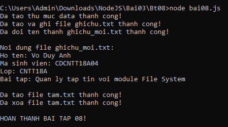

## 1. Nội dung thực hiện

Sử dụng module `fs` trong Node.js để:

- Tạo thư mục `data` và tập tin `ghichu.txt`.
- Ghi ít nhất 3 dòng nội dung vào tập tin.
- Đổi tên `ghichu.txt` thành `ghichu_moi.txt` bằng `fs.rename()`.
- Đọc và hiển thị nội dung tập tin sau khi đổi tên.
- Tạo tập tin `tam.txt`, sau đó xóa bằng `fs.unlink()`.
- Hiển thị thông báo kết quả từng thao tác.

## 2. Lệnh thực hiện

**Di chuyển đến thư mục Bt08:**

```cmd
cd /d C:\Users\Admin\Downloads\NodeJS\Bai03\Bt08
```

**Chạy chương trình:**

```cmd
node bai08.js
```

## 3. Hình ảnh chạy chương trình và kết quả



## 4. Kết quả cuối cùng

- Tạo thành công thư mục `data`.
- Tập tin `ghichu.txt` được đổi tên thành `ghichu_moi.txt`.
- Đọc và hiển thị thành công nội dung tập tin.
- Tập tin `tam.txt` được tạo và xóa thành công.

Cấu trúc thư mục sau khi thực hiện:

```text
Bt08/
├── bai08.js
├── Readme.md
├── data/
│   └── ghichu_moi.txt
└── images/
    └── ket-qua-bai08.png
```